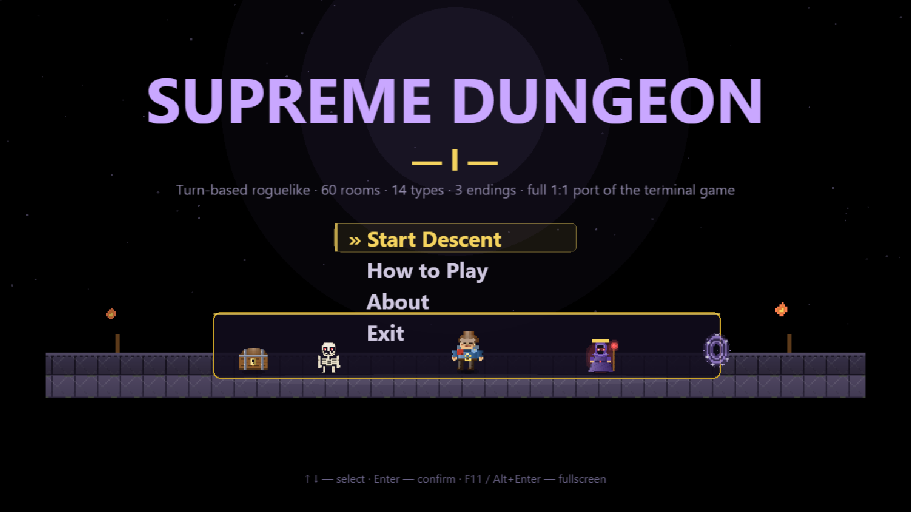
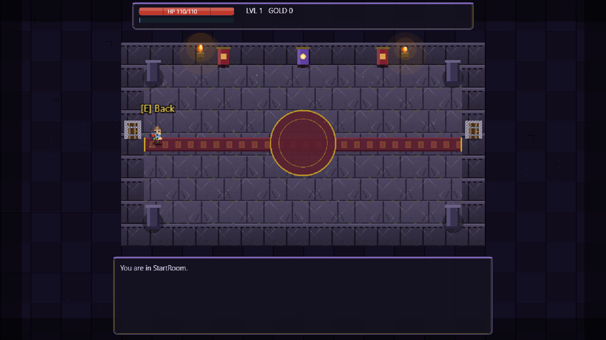
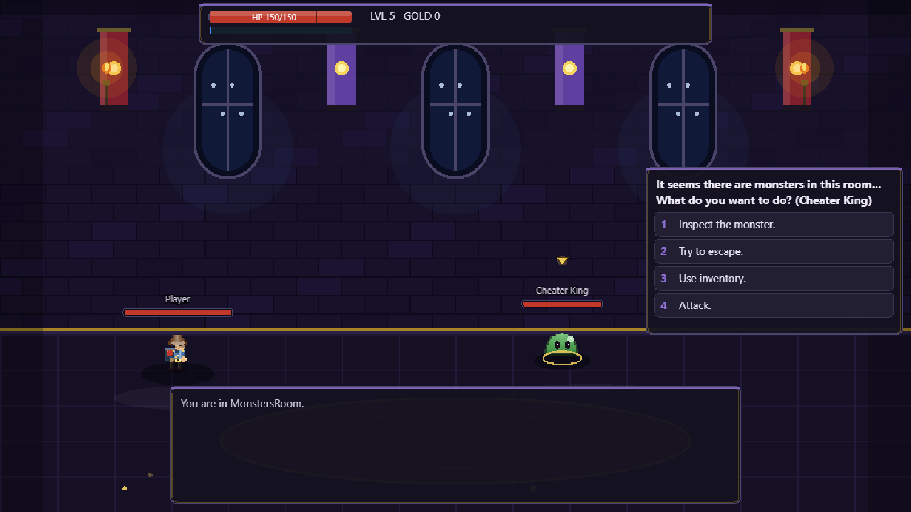
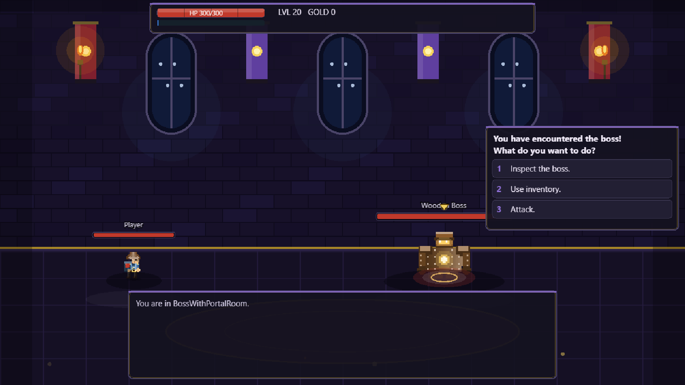
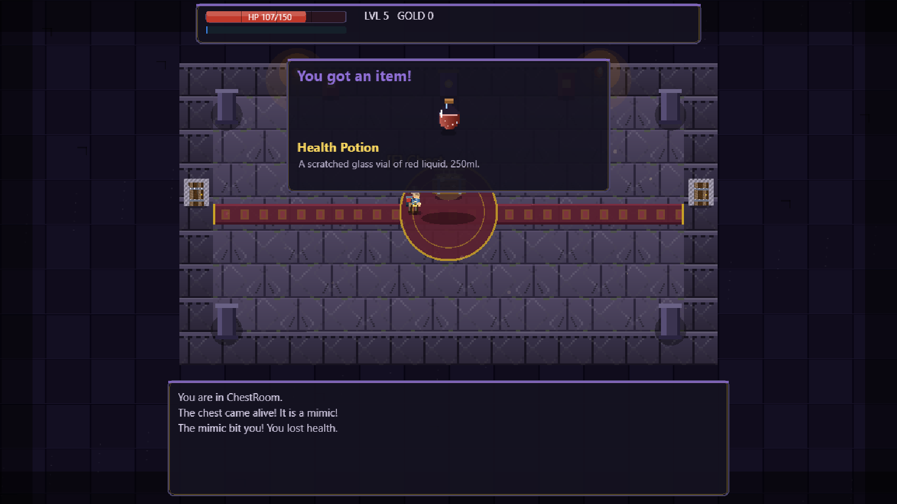

# Supreme Dungeon I

[](https://github.com/LeviTankTV/SD1/releases/latest) [](https://github.com/LeviTankTV/SD1/releases/latest) [](LICENSE)

**Turn-based roguelike · 60 rooms · 14 room types · 3 endings · full 1:1 port of the terminal game.**

You wake up in a dark dungeon of 60 rooms. Fight monsters and skeletons, open chests (beware mimics!), bargain with 6 mages, face the **Supreme Mage** with all 20 of his attacks, beat the boss, solve the scroll riddle — and choose your ending: doom, emperor, or the true portal.



## Screenshots

| Room | Battle |
|---|---|
|  |  |

| Boss | Loot |
|---|---|
|  |  |

## Features

- 60-room dungeon: monster lairs, skeleton ambushes, dark chests, locked doors, secret passages, fountains of life and wisdom, a shop, a riddle scroll
- Turn-based combat with crits, bows (incl. triple-shot CrossBow), status effects (burning, frozen), escape and negotiation
- 6 mages with unique trades — and the Supreme Mage boss battle with 20 different attacks
- Mimics, cursed blade, Dark Secret, night-vision mechanics
- 3 endings: death, Emperor, true portal ending
- Pause menu (ESC), animated hero with walk cycle, cinematic chest opening, particles and screen shake
- English localization, no saves — just like the original

## Controls

| Key | Action |
|---|---|
| WASD | Walk around the room |
| E | Doors, chests, fountains, mages, riddles |
| I | Inventory |
| 1–6 | Menu and battle actions |
| Y / N | Yes / No |
| Enter | Start / confirm |
| ESC | Pause menu (resume / exit to title) |
| F11 or Alt+Enter | Fullscreen |

## Download — v1.0.0

| File | OS | How to run |
|---|---|---|
| `SupremeDungeonI-1.0.0-portable.exe` (~77 MB) | Windows 10/11 x64 | Download and run — no install needed |
| `SupremeDungeonI-1.0.0-setup.exe` (~78 MB) | Windows 10/11 x64 | Installer with Start-menu shortcut |
| `SupremeDungeonI-1.0.0-linux-x64.tar.gz` (~120 MB) | Linux x64 | Extract and run `./supreme-dungeon-i` |

System requirements: 64-bit OS, ~300 MB disk, any GPU from the last 10 years (PixiJS WebGL, software fallback included).

> The Windows builds are not code-signed, so SmartScreen may warn on first launch: **More info → Run anyway**.

Linux run:
```bash
tar -xzf SupremeDungeonI-1.0.0-linux-x64.tar.gz
cd linux-unpacked
./supreme-dungeon-i
```

## For developers

```bash
npm install
npm test        # 42 gameplay tests (1:1 with the terminal original)
npm run shot    # screenshot gate — 22 scenes
npm run dist:win / dist:linux
```

Built with Electron + PixiJS. Game logic lives in `src/core/` and is fully covered by tests.
